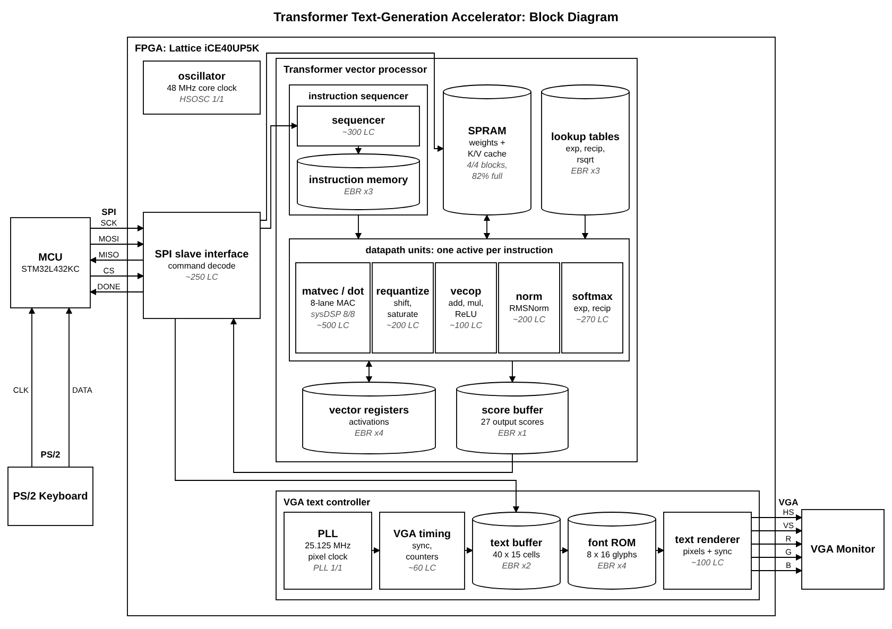

# ice40-transformer-accelerator

E155 final project: a 2-layer character-level transformer running on an
iCE40UP5K, with an STM32L432KC host, PS/2 keyboard input and VGA text output.

## Layout

| Path | Contents | Owner |
|---|---|---|
| `fpga/rtl/gpt_pkg.sv` | shared constants, instruction format | Zach |
| `fpga/rtl/top.sv` | top-level wiring | shared |
| `fpga/rtl/exec/` | MAC lanes, MATVEC, requantize, vecop, KVSTORE | Angela |
| `fpga/rtl/mem/` | SPRAM wrapper, vector registers, score buffer | Angela |
| `fpga/rtl/ctrl/` | SPI slave, command decoder, sequencer, RMSNorm, softmax | Zach |
| `fpga/rtl/vga/` | VGA timing, text buffer, font ROM, renderer | Angela |
| `fpga/ip/` | Radiant IP Catalog output (PLL) | |
| `fpga/mem/` | ROM contents (font, lookup tables) | |
| `fpga/constraints/` | pin constraints (`.pdc`) | |
| `fpga/sim/tb/` | testbenches | |
| `fpga/syn/` | Radiant command-line build scripts | |
| `model/` | training, bit-exact reference model, assembler | Zach |
| `model/golden/` | small Python models of single instructions | Angela |
| `mcu/` | MCU firmware | both |
| `tools/` | helper scripts | |

Generated files (test vectors, `spram.mem`, `prog.mem`, build output) are
not committed; see `.gitignore`.
